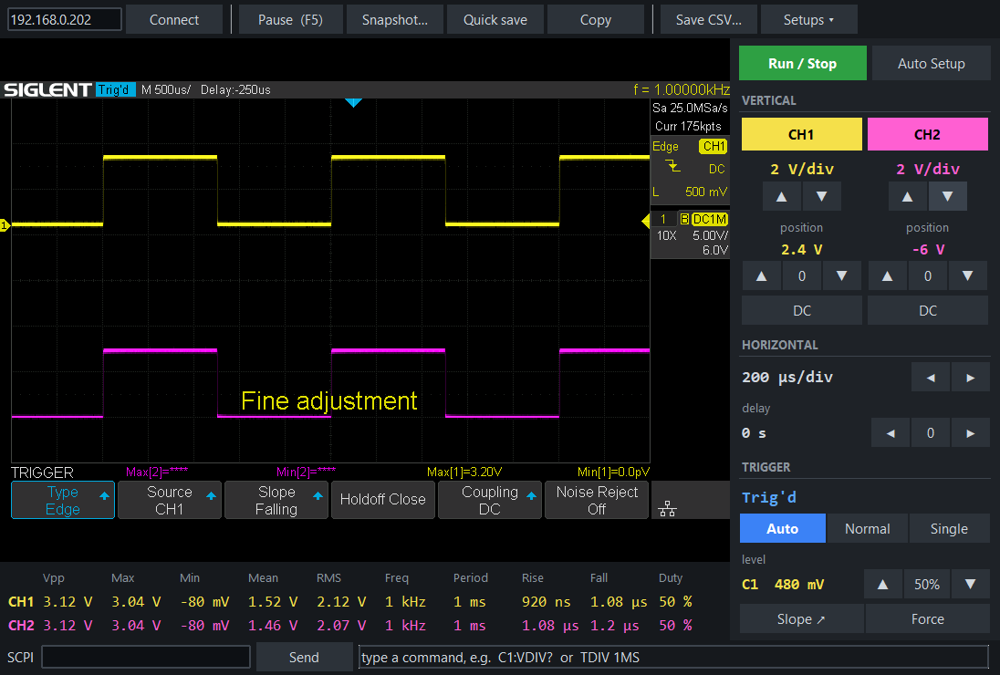
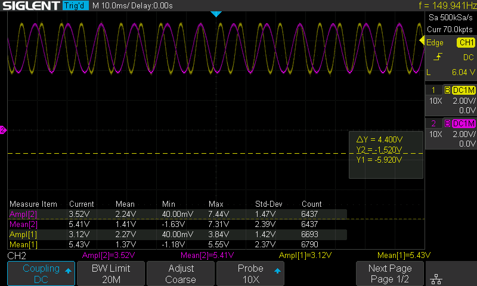

# Siglent Viewer

**Version 1.1**

A live screen viewer and remote front panel for the Siglent SDS1202X-E
oscilloscope, for Windows. It streams the scope's display to your PC over the
network, saves or copies screenshots with one click, and lets you drive the
scope and save and restore its complete setup.

It is a single Python file that talks to the scope directly over the network.
There are no drivers and no NI-VISA to install.



## Why

The software that comes with the scope is awkward to get working, and the usual
fallback is photographing the screen with a phone. This replaces that: press
**Copy** and paste a pixel-perfect screenshot straight into an email or chat.

## Features

- **Live view** of the scope screen at about 8–10 frames per second, in a
  resizable window. `F5` pauses and resumes.
- **Screenshots**
  - **Snapshot…** (`Ctrl+Shift+S`) saves a PNG, BMP or JPEG wherever you choose.
  - **Quick save** (`Ctrl+S`) drops a timestamped PNG into a `captures` folder.
  - **Copy** (`Ctrl+C`) puts the screen on the clipboard.
- **Front-panel controls**, laid out in the same order as the scope:
  - Run/Stop and Auto Setup.
  - Vertical: channel on/off, V/div, position and coupling for each channel.
  - Horizontal: timebase and trigger delay.
  - Trigger: Auto/Normal/Single, level, 50 %, slope and Force.
- **Save and restore setups.** Once the scope is configured for a job, save the
  whole configuration under a name and return to it later with one click. See
  [Setups](#setups).
- **Measurements table** for each active channel: Vpp, max, min, mean, RMS,
  frequency, period, rise and fall time, and duty cycle.
- **Waveform export** to CSV: the actual samples as time and volts for every
  channel that is switched on, with time relative to the trigger point.
- **SCPI box** for sending any raw command to the scope and seeing the reply.

Screenshots are saved exactly as the scope draws them, at its native 800 × 480:



## Requirements

- Windows 10 or 11
- Python 3.10 or newer
- A Siglent SDS1202X-E on the same network as the PC

It has only been tested on an SDS1202X-E with firmware 1.3.27. Other
SDS1000X-E models use the same command set and may work, but are untested.

## Getting started

1. Connect the scope to your network and note its IP address (it is in the
   scope's Utility menu, under I/O).
2. Install the two libraries the viewer needs:

   ```
   pip install -r requirements.txt
   ```

3. Start the viewer by double-clicking `Siglent Viewer.bat`, or run:

   ```
   python siglent_viewer.py 192.168.0.202
   ```

4. If you started it without an address, type the scope's IP address into the
   box at the top left and press **Connect**. The address is remembered for
   next time.

## Setups

The **Setups ▾** button saves and restores the scope's entire configuration,
exactly as the scope itself reports it: channels, timebase, trigger and the
rest, so you do not have to set everything up again by hand.

- **Save current setup…** asks for a name and stores the configuration as a
  file in the `setups` folder.
- Every saved setup then appears by name in the same menu. Click one to restore
  it.
- **Load from file…** restores a setup file kept somewhere else.

Saving takes about four seconds, because the scope is slow to hand the setup
over. Restoring takes about two. The picture freezes briefly during each.

## Known issues

- **The scope can become laggy or unresponsive after long periods of
  streaming.** With the viewer left running, the scope has on occasion become
  sluggish or stopped responding altogether, on its own front panel as well as
  over the network, and needed switching off and on again. The cause has not
  been found, and it could not be reproduced in testing: 12 minutes of
  continuous streaming, rapid setting changes and repeatedly dropped
  connections all left the scope healthy. Until it is understood, pause the
  stream with `F5` or close the viewer when you are not watching it.
- **Each control click briefly pauses the picture.** The scope silently ignores
  commands that arrive within about a tenth of a second of a setting change, so
  the viewer waits a quarter of a second after each one.
- **The scope's menu buttons are not on the panel.** Cursors, Measure, Acquire,
  Math and the like have no on-screen buttons. The SCPI box can reach most of
  them.
- **Windows only.** The clipboard and window handling use Windows calls.

The viewer keeps a log, `siglent_viewer.log`, next to the script. It records
every connection, missed answer and slow screenshot, plus a health line once a
minute, which is useful when reporting a problem.

## How it works

The scope accepts text commands (SCPI) on TCP port 5025. The viewer holds one
connection open and sends one request at a time: `SCDP` returns the screen as a
bitmap, `PNSU?` returns the setup, and ordinary queries such as `C1:VDIV?`
return settings. A background thread does all the talking so the window stays
responsive.

## Version history

- **1.1** — Recovers from a missed answer on the same connection instead of
  reconnecting, closes the connection cleanly on exit, and adds the log file.
- **1.0** — First release: live view, screenshots, front-panel controls,
  measurements, CSV export and setup save and restore.

## Disclaimer

This is an independent project. It is not affiliated with or endorsed by
Siglent Technologies.
